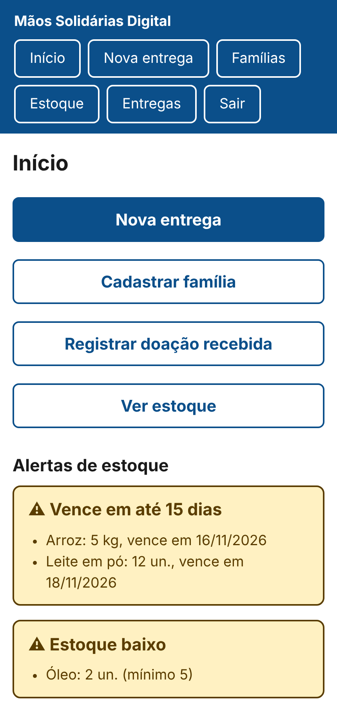
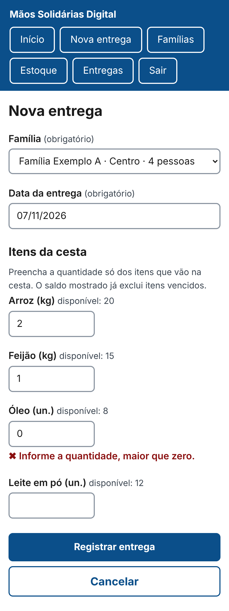
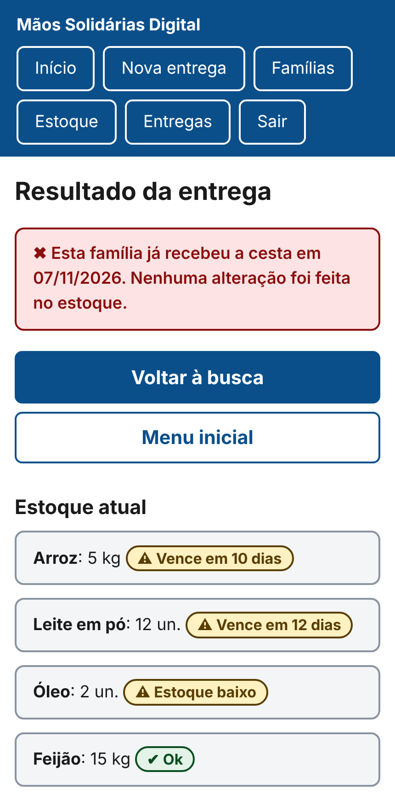

# Mãos Solidárias Digital (MVP)

Sistema web para uma associação que distribui cestas básicas controlar **famílias atendidas**, **estoque com validade** e **entregas mensais**, com **bloqueio automático de uma segunda cesta para a mesma família no mesmo mês**.

Projeto da disciplina de Projeto de Software (ADS). Alinha-se ao **ODS 2 (Fome Zero e Agricultura Sustentável), meta 2.1**, no contexto limitado de uma associação local.

> **Dados fictícios.** O nome da associação, as famílias e os itens usados nesta documentação e nas imagens são fictícios. Nenhum dado pessoal real está neste repositório.

## O problema

O controle manual das entregas permite que a mesma família receba mais de uma cesta no mês, deixa o estoque desatualizado e faz alimentos vencerem sem aviso. O MVP resolve o fluxo mínimo: **entrar, registrar a entrega e conferir o resultado**.

## Funcionalidades

| Código | Funcionalidade |
|---|---|
| RF01 | Cadastro e busca de famílias (aviso de possível duplicidade; inativação em vez de exclusão) |
| RF02 | Estoque em lotes com validade; saída pelo lote que vence primeiro; descarte de vencidos |
| RF03 | Registro de entrega com baixa de estoque e **bloqueio de segunda cesta no mês** |
| RF04 | Alertas: vence em até 15 dias, vencido e estoque abaixo do mínimo |
| RF05 | Relatório mensal (somente presidente), com exportação em CSV |

Uma entrega cancelada pela presidente devolve o estoque (estorno) e libera o mês para a família.

## Telas do protótipo

Imagens do protótipo das três telas principais (dados fictícios). Elas reproduzem o CSS e a estrutura dos templates do sistema.

| Menu inicial | Nova entrega | Resultado (bloqueio) e estoque |
|---|---|---|
|  |  |  |

## Tecnologias

- Python 3.12+ e Django 5.2 LTS
- SQLite (desenvolvimento) e PostgreSQL (produção, por variáveis de ambiente)
- pytest e pytest-django nos testes
- whitenoise e gunicorn na implantação
- CSS próprio, sem dependências externas

## Arquitetura

Monolito em camadas, no estilo MVT do Django:

```
Templates (apresentação)  →  Views (controle)  →  Services (regras de negócio)  →  Models (persistência)
```

- `templates/`: HTML responsivo, sem scripts nem estilos inline.
- `core/views.py`: login, validação de formato e chamada dos serviços.
- `core/services.py`: **regras de negócio** (uma cesta por família/mês, baixa FIFO por validade, alertas, relatório).
- `core/models.py`: persistência. A restrição de uma entrega ativa por família/mês existe **também no banco**.

## Como rodar

```bash
python -m venv .venv && source .venv/bin/activate     # Windows: .venv\Scripts\activate
pip install -r requirements.txt
export DJANGO_DEBUG=1                                  # PowerShell: $env:DJANGO_DEBUG="1"
python manage.py makemigrations core
python manage.py migrate
python manage.py criar_usuario presidente --perfil presidente --nome "Presidente"
python manage.py criar_usuario voluntaria --perfil voluntario
python manage.py runserver
```

Acesse http://127.0.0.1:8000/. O painel interno fica em `/gestao-interna/` (somente presidente). A senha é pedida no terminal e nunca fica gravada em arquivo.

`makemigrations` cria a pasta `core/migrations/`, que deve ser mantida no repositório (a hospedagem roda só `migrate`).

Primeiro uso: entre como presidente, cadastre os itens em **Estoque → Novo item**, registre as doações, cadastre famílias e use **Nova entrega**.

## Testes

```bash
pytest                          # regras de negócio e segurança
python manage.py check --deploy # verificações de segurança do Django
```

- `core/tests/test_services.py`: testes unitários das regras (duplicidade, estoque FIFO, validade, cancelamento, alertas, relatório).
- `core/tests/test_views.py`: testes de integração pelas telas (login, perfis, XSS, injeção de SQL, fluxo de entrega e bloqueio).

Dados de demonstração para medir desempenho (200 famílias, 30 itens, 12 meses de entregas, tudo fictício):

```bash
python manage.py seed_demo
```

## Segurança

- Senhas com PBKDF2-SHA256 e validadores de senha do Django.
- Sessão de 30 minutos de inatividade, cookies `HttpOnly`, `Secure` e `SameSite`, proteção CSRF.
- Todas as telas exigem login (negado por padrão); o perfil é verificado no servidor (403 para funções restritas).
- Bloqueio de login por 15 minutos após 5 tentativas erradas, com mensagens genéricas.
- Política de segurança de conteúdo (CSP), cabeçalhos de segurança e páginas sem cache.
- Entradas validadas no servidor, saída escapada nos templates, consultas parametrizadas pelo ORM.
- Segredos somente em variáveis de ambiente; `DEBUG` desligado em produção; painel administrativo em endereço não padrão.

## Acessibilidade

- Alvos de toque de pelo menos 44 px, texto grande e contraste mínimo de 4,5:1.
- Foco visível e rótulos associados a cada campo.
- Alertas sempre com **texto, símbolo e cor**, nunca só a cor.
- Leiaute em coluna única, legível com zoom de 200%.

## Variáveis de ambiente

| Variável | Uso |
|---|---|
| `DJANGO_SECRET_KEY` | obrigatória em produção |
| `DJANGO_DEBUG` | `0` em produção |
| `DJANGO_ALLOWED_HOSTS` | domínios separados por vírgula |
| `DJANGO_CSRF_TRUSTED_ORIGINS` | ex.: `https://meu-app.onrender.com` |
| `POSTGRES_DB`, `POSTGRES_USER`, `POSTGRES_PASSWORD`, `POSTGRES_HOST`, `POSTGRES_PORT` | se `POSTGRES_DB` existir, usa PostgreSQL |
| `ALERTA_VALIDADE_DIAS` | janela do alerta de validade (padrão 15) |

## Implantação (resumo)

```bash
pip install -r requirements.txt
python manage.py migrate
python manage.py collectstatic --noinput
gunicorn config.wsgi
```

Em produção o site exige HTTPS. Faça backup periódico do banco e exporte o relatório antes de cada dia de distribuição.

## Estrutura do repositório

```
config/            configuração do projeto (settings, urls, wsgi)
core/              aplicação (models, services, views, forms, middleware)
core/management/   comandos criar_usuario e seed_demo
core/tests/        testes unitários e de integração
templates/         páginas HTML
static/css/        estilo próprio
docs/              imagens do protótipo e modelo de Pull Request
scripts/           script que cria o histórico de commits
```

## Limitações conhecidas do MVP

- O bloqueio de login usa o cache em memória do servidor; com vários processos, configure um cache compartilhado.
- A janela do alerta de validade é ajustada por variável de ambiente, não por tela.
- Agendamento de retirada e cadastro de doadores ficam fora do escopo (evolução futura).

## Convenção de commits

Mensagens no padrão `tipo: descrição` (`feat`, `fix`, `test`, `docs`, `chore`, `ci`). Mudanças entram na `main` por Pull Request.
